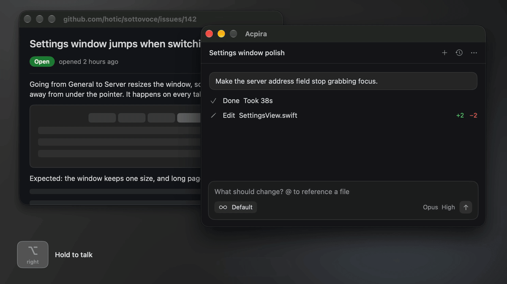
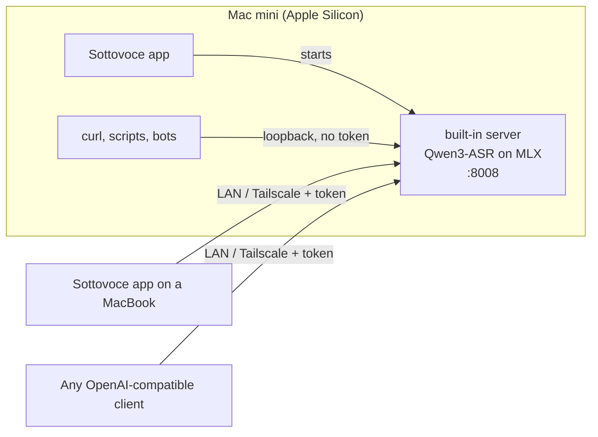

<p align="center">
  
</p>

<h1 align="center">Sottovoce</h1>

<p align="center">
  <strong>Lightweight, fully local speech recognition.</strong><br>
  Hold a key, talk, let go. A native Liquid Glass app with an OpenAI-compatible API built in.
</p>

<p align="center">
  <a href="LICENSE"></a>
  
  
</p>

<p align="center"><strong>English</strong> ｜ <a href="README.zh.md">简体中文</a></p>

<p align="center"></p>

Sottovoce turns an Apple Silicon Mac into a speech-to-text server. It loads the speech model once and keeps it ready, so a short sentence comes back as text in about a third of a second. Apps on the same Mac can use it, and so can your other computers over the local network or Tailscale. Your audio never leaves your own machines.

The name is the musical direction *sotto voce*: "in a low voice".

- **High accuracy.** It runs [Qwen3-ASR](https://huggingface.co/Qwen/Qwen3-ASR-1.7B), an open speech recognition model that made far fewer mistakes than Whisper in our tests. It understands Chinese, English, and many other languages.
- **Easy to install.** One app: open it, pick a model size, and it downloads the model and runs the server by itself. No Python, no Terminal.
- **Works with existing tools.** Apps that can use OpenAI's speech-to-text API can use Sottovoce instead by changing one address.
- **Learns your words.** Add names and terms it keeps getting wrong, and choose exactly how they should be spelled.
- **A dictation app.** Hold a key, speak, release. The text lands in whatever field has focus.
- **One server for many machines.** Turn on sharing on a Mac mini and dictate from a MacBook anywhere on your Tailscale network.

## How it fits together



The server needs Apple Silicon. It runs inside the app, or on its own as a command-line program. Clients only need HTTP, so any OS can use it. There is no native Windows dictation client yet. One is planned, and until then Windows machines can call the API directly.

## Install

You need an Apple Silicon Mac with macOS 14 or later.

1. Download `Sottovoce-<version>.dmg` from [Releases](https://github.com/hotic/sottovoce/releases/latest), open it, and drag Sottovoce into Applications. Apple has checked the app (it is notarized), so it opens without warnings.
2. Open Sottovoce. It lives in the menu bar, and its welcome window asks for Accessibility and Microphone access.
3. Pick a model size and press Download. The download can run in the background: the menu bar icon shows its progress, and the welcome window comes back when the model is ready.
4. Hold right ⌥, talk, and let go.

The download itself is about 30 MB, because the models are not inside it. On first launch the app fetches what it needs from Hugging Face, once:

| Model | Download size | Role |
|---|---|---|
| `mlx-community/Qwen3-ASR-1.7B-8bit` | 2.3 GB | Default, most accurate |
| `mlx-community/Qwen3-ASR-0.6B-8bit` | 1.0 GB | Lighter, a little less accurate; choose it in the welcome window or Settings › Server |
| `mlx-community/SenseVoiceSmall` | 0.9 GB | Powers live preview; skipped while live preview is off |

Models are kept in `~/.cache/huggingface/hub`, where `huggingface-cli` keeps them too, so a model you already have is not downloaded again. An interrupted download picks up where it stopped. When huggingface.co can't be reached, the app tries the hf-mirror.com mirror.

The app keeps itself up to date. Once a day it checks this repository's Releases, downloads a new version in the background, and installs it the next time it quits. Updates are signed, and the app refuses one that isn't. Turn this off with Update automatically in Settings › General; Check for Updates… in the menu checks right away.

## Run the server without the app

The server is also a single command-line program, for a Mac without anyone logged in or for scripts. Building it needs [Rust](https://rustup.rs) and Xcode.

```sh
xcodebuild -downloadComponent MetalToolchain      # once; needed to compile MLX's Metal kernels
huggingface-cli download mlx-community/Qwen3-ASR-1.7B-8bit
huggingface-cli download mlx-community/SenseVoiceSmall   # optional, powers live preview

cargo build --release        # the first build compiles MLX from source, about 5 minutes
target/release/sottovoce     # add --preview-model= if you skipped SenseVoice
```

Then transcribe a file:

```sh
curl -F file=@speech.m4a http://127.0.0.1:8008/v1/audio/transcriptions
```

On its own the server never downloads models. `--model` takes a local directory or a Hugging Face repo name, read from `~/.cache/huggingface/hub`. A WAV that is already 16 kHz mono 16-bit is read directly. Other formats, such as MP3, M4A/AAC, CAF, and Opus, go through ffmpeg, so install it with `brew install ffmpeg` if you send them. The dictation app always sends that kind of WAV, so it doesn't need ffmpeg.

The app's server listens on port 8008; if another app needs that port, change it under Settings › Server. When a Sottovoce server already answers on the port, the app uses it instead of starting its own.

### Options

Every flag also has an environment variable, which is handier in a LaunchAgent.

| Flag | Environment | Default |
|---|---|---|
| `--host` | `SOTTOVOCE_HOST` | `127.0.0.1` |
| `--port` | `SOTTOVOCE_PORT` | `8008` |
| `--model` | `SOTTOVOCE_MODEL` | `mlx-community/Qwen3-ASR-1.7B-8bit` |
| `--preview-model` | `SOTTOVOCE_PREVIEW_MODEL` | `mlx-community/SenseVoiceSmall`; empty disables it |
| `--language` | `SOTTOVOCE_LANGUAGE` | auto-detect; set e.g. `zh` to force one |
| `--hotwords` | `SOTTOVOCE_HOTWORDS` | `~/.config/sottovoce/hotwords.txt`; empty disables it |
| `--ffmpeg` | `SOTTOVOCE_FFMPEG` | `/opt/homebrew/bin/ffmpeg` |
| | `SOTTOVOCE_TOKEN` | unset; the bearer token required from non-loopback clients |

Memory use, measured with Activity Monitor rather than `ps`, since MLX keeps weights in GPU buffers:

| Setup | Memory |
|---|---|
| Qwen3-ASR 1.7B only | about 2.5 GB |
| 1.7B plus SenseVoice preview | about 5 GB |
| Qwen3-ASR 0.6B only | about 1.1 GB |

Requests are processed one at a time in arrival order.

### Run it in the background

`deploy/sh.asgard.sottovoce.server.plist` is a LaunchAgent template that starts the server at login and restarts it if it crashes. The install commands are in the comment at the top of the file. Logs go to `/tmp/sottovoce.log`, one line per transcription.

## Serve other machines

In the app, turn on Settings › Server › Share with other devices. It lists this Mac's addresses and a token. On the other Mac, choose Remote and enter one of the addresses and the token.

For a server run on its own:

1. Set the host to `0.0.0.0`.
2. Set `SOTTOVOCE_TOKEN` to a random value, for example from `openssl rand -hex 24`.
3. Restart the server and allow incoming connections when the macOS firewall asks.

Remote clients send `Authorization: Bearer <token>`. Requests from `127.0.0.1` and `::1` never need it, so local clients keep working unchanged. The traffic is plain HTTP, so keep it on a trusted network such as Tailscale.

## API

| Endpoint | Purpose |
|---|---|
| `GET /health` | Liveness check. Never needs the token. |
| `GET /v1/models` | Model list. |
| `POST /v1/audio/transcriptions` | Multipart upload in the OpenAI format. |
| `POST /v1/chat/completions` | Audio inside a chat message, as vLLM serves Qwen3-ASR. |

Fields for `/v1/audio/transcriptions`:

- **`file`**: the audio.
- **`language`**: a language code such as `zh`.
- **`prompt`**: context that biases recognition, such as the topic or the names of the people talking.
- **`hotwords`**: a comma-separated list of terms. This is an extension to the OpenAI API.
- **`response_format`**: `json`, `text`, or `verbose_json`.
- **`model`**: ignored, except that `preview` selects the fast preview model. Preview ignores prompts and hotwords, and returns 400 when the preview model isn't loaded.

For `/v1/chat/completions`, put the audio in the message content as `input_audio` with base64 data and a `format`, or as an `audio_url` data URI. A system message becomes the context prompt. `stream: true` is accepted and returns the whole result in one chunk.

```sh
curl http://127.0.0.1:8008/v1/chat/completions -H 'Content-Type: application/json' -d '{
  "messages": [{"role": "user", "content": [
    {"type": "input_audio", "input_audio": {"data": "'"$(base64 -i speech.wav)"'", "format": "wav"}}
  ]}]
}'
```

Errors use FastAPI's shape, `{"detail": "..."}`. Undecodable audio returns 400.

## Hotwords

Put names the model keeps mishearing in `~/.config/sottovoce/hotwords.txt`. Changes apply on the next request without a restart. Text after `#` is a comment, and there are two kinds of lines:

```
Sottovoce                     # a hotword: biases recognition toward this term
Qwen 3 ASR                    # write hotwords the way they are spoken
qwen\s*3[\s-]*asr => Qwen3-ASR   # a replacement rule: regex => replacement
```

- **Hotwords** apply to every final transcription and merge with the request's own `hotwords`. The preview model ignores them.
- **Replacement rules** are case-insensitive and run on the recognized text, for both final and preview results. A hotword makes the model hear the right sound, but spelling can still vary between `Qwen3`, `Qwen 3`, and so on. A rule pins it down.

Hotwords are strong. A term with a similar-sounding neighbor will swallow it, even when the neighbor is what was actually said. Keep the list to terms that don't collide with everyday words. Test a new rule on a few sentences that could be confused with it, because a rule that is too broad rewrites normal speech.

## Dictation app

`app/` holds a macOS menu bar app written in SwiftUI with no third-party dependencies. It needs macOS 14 or later and works in English and Simplified Chinese.

- **Hold to talk.** Hold the hotkey, speak, and release. The default hotkey is right ⌥. Right ⌘, right ⌃, right ⇧, and fn also work. Pressing another key while holding cancels, since it was probably a shortcut.
- **Talk first, aim later.** Start talking wherever you are, keep reading or browsing, then click into the field you want and let go. The text goes wherever the cursor is when you release the key.
- **Hands-free.** Optionally, tap once to start and tap again to stop. Esc cancels.
- **Live preview.** While you talk, the fast preview model's text appears directly in the focused field and is replaced in place by the final result. Fields that don't expose themselves through Accessibility, such as those in many Electron apps, get the final text pasted instead.
- **Pick a field afterwards.** When focus is clearly not a text field, such as the Finder desktop or a list, the app waits for you to click into one. After 60 seconds the text goes to the clipboard.
- **Clipboard safety net.** The result can stay on the clipboard, so a failed insert or a cancel never loses what you said.
- **Fast start.** The microphone stays warm for 2 minutes after use. An always-on option also keeps the 0.3 seconds before you press the key.
- **Built-in or remote.** By default the app runs the server itself: it starts with the app and stops when you quit. Or enter another Mac's address and token to use its server instead.

The built-in server logs to `~/Library/Logs/Sottovoce/server.log`. To build the app from source:

```sh
app/build.sh             # builds app/build/Sottovoce.app with the server inside
app/build.sh --install   # also copies it to /Applications and relaunches it
```

The first build also compiles MLX, which takes about 5 minutes. A build from source is signed with a self-signed certificate that the build script creates in its own keychain. Rebuilds keep the same signature, so the Accessibility and Microphone permissions survive.

## Choosing the model

Character error rate on 60 utterances from each of two WenetSpeech test sets, measured on an M4 Pro Mac mini in October 2026. Lower is better.

| Model | test_meeting | test_net | Median latency |
|---|---|---|---|
| **Qwen3-ASR-1.7B-8bit** | 6.64% | 4.23% | ~260 ms |
| Qwen3-ASR-0.6B-8bit | 6.70% | 6.13% | ~135 ms |
| SenseVoice-Small | 9.02% | 5.87% | ~25 ms |
| GLM-ASR-Nano-8bit | 9.08% | 6.04% | ~270 ms |
| FireRedASR2-AED (MLX) | 4.57% | 7.68% | ~540 ms |
| whisper-large-v3-turbo | 39.51% | 9.58% | ~500 ms |

The sample is small, so treat differences under one point as noise. The test_meeting references keep filler words, which Whisper drops, and those count as errors.

The forward passes of Qwen3-ASR and SenseVoice are ported layer by layer from [mlx-audio](https://github.com/Blaizzy/mlx-audio) 0.5.9. On the same audio, the Rust server produces exactly the same tokens as the Python reference.

## Roadmap

- A native Windows dictation client that talks to a Sottovoce server.
- Request priority, so live dictation jumps ahead of batch jobs.

## Acknowledgements

Sottovoce stands on [Qwen3-ASR](https://github.com/QwenLM/Qwen3-ASR), [SenseVoice](https://github.com/FunAudioLLM/SenseVoice), [MLX](https://github.com/ml-explore/mlx), [mlx-rs](https://github.com/oxiglade/mlx-rs), and [mlx-audio](https://github.com/Blaizzy/mlx-audio), and updates through [Sparkle](https://sparkle-project.org). Model weights are downloaded separately and keep their own licenses.

## License

[MIT](LICENSE)
