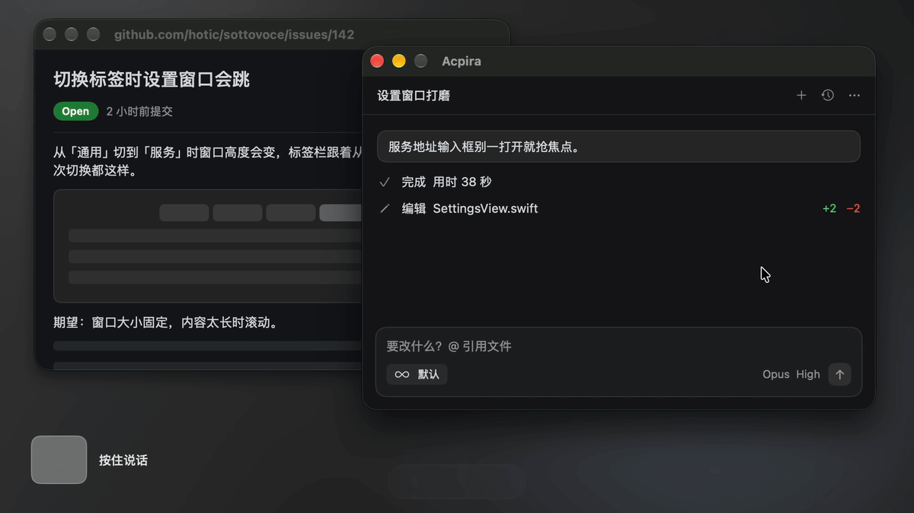
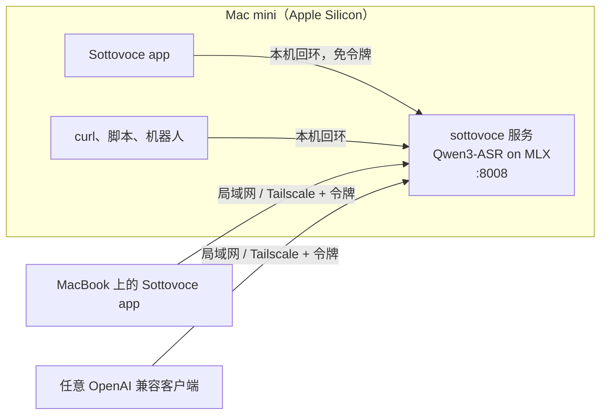

<p align="center">
  
</p>

<h1 align="center">Sottovoce</h1>

<p align="center">
  <strong>留在你 Mac 上的语音识别。</strong><br>
  一个常驻模型，一套 OpenAI 兼容接口，再加一个按住说话的听写 app。
</p>

<p align="center">
  <a href="LICENSE"></a>
  
  
</p>

<p align="center"><a href="README.md">English</a> ｜ <strong>简体中文</strong></p>

<p align="center"></p>

Sottovoce 把一台 Apple Silicon Mac 变成语音转文字服务器。语音模型只加载一次、一直待命，一句话说完，大约三分之一秒就能拿到文字。同一台 Mac 上的 app 能用，你的其他电脑也能通过局域网或 Tailscale 来用。录音始终留在你自己的机器上。

名字取自乐谱术语 sotto voce，意思是「压低声音」。

- **识别准确。** 使用开源语音识别模型 [Qwen3-ASR](https://huggingface.co/Qwen/Qwen3-ASR-1.7B)，实测错字比 Whisper 少得多。中文、英文和其他多种语言都能识别。
- **部署简单。** 服务端就是一个小程序，不用装 Python，也没有别的东西要维护。
- **现有工具直接接入。** 支持 OpenAI 语音转文字接口的 app，改一个地址就能用 Sottovoce。
- **记得住你的词。** 总被听错的名字和术语可以加进去，还能指定它们的写法。
- **听写 app。** 按住快捷键说话，松手，文字落进当前输入框。
- **一台服务多台机器用。** 服务跑在 Mac mini 上，MacBook 在 Tailscale 网络里任何地方都能听写。

## 整体结构



服务端需要 Apple Silicon，客户端只要能发 HTTP 请求，什么系统都行。目前还没有 Windows 原生听写客户端，已列入计划；在那之前，Windows 机器可以直接调接口。

## 快速开始

需要：macOS 14 及以上的 Apple Silicon Mac、[Rust](https://rustup.rs)、Xcode 和 Homebrew。目前还没有打包好的安装包，需要从源码编译。

模型不随程序打包。Sottovoce 自己不会下载任何东西，模型要从 Hugging Face 下载一次：

| 模型 | 下载大小 | 用途 |
|---|---|---|
| `mlx-community/Qwen3-ASR-1.7B-8bit` | 2.3 GB | 缺省，最准 |
| `mlx-community/Qwen3-ASR-0.6B-8bit` | 1.0 GB | 更快更省内存，准确度略低 |
| `mlx-community/SenseVoiceSmall` | 0.9 GB | 可选，听写 app 的实时预览要用 |

服务端程序本身约 25 MB。

```sh
brew install ffmpeg
xcodebuild -downloadComponent MetalToolchain      # 只需一次：编译 MLX 的 Metal 内核要用
huggingface-cli download mlx-community/Qwen3-ASR-1.7B-8bit
huggingface-cli download mlx-community/SenseVoiceSmall   # 可选，实时预览要用

cargo build --release        # 首次构建要从源码编译 MLX，约 5 分钟
target/release/sottovoce     # 没下 SenseVoice 时加 --preview-model=
```

然后转写一个文件：

```sh
curl -F file=@speech.m4a http://127.0.0.1:8008/v1/audio/transcriptions
```

服务从不下载模型。`--model` 可以是本地目录，也可以是 Hugging Face 仓库名，按仓库名时从 `~/.cache/huggingface/hub` 读取。音频交给 ffmpeg 解码，WAV、MP3、M4A / AAC、CAF、Opus 等格式都能直接传。已经是 16 kHz 单声道 16 bit 的 WAV 不经过 ffmpeg。

### 参数

每个参数都有对应的环境变量，写在 LaunchAgent 里更方便。

| 参数 | 环境变量 | 缺省值 |
|---|---|---|
| `--host` | `SOTTOVOCE_HOST` | `127.0.0.1` |
| `--port` | `SOTTOVOCE_PORT` | `8008` |
| `--model` | `SOTTOVOCE_MODEL` | `mlx-community/Qwen3-ASR-1.7B-8bit` |
| `--preview-model` | `SOTTOVOCE_PREVIEW_MODEL` | `mlx-community/SenseVoiceSmall`，传空字符串不加载 |
| `--language` | `SOTTOVOCE_LANGUAGE` | 自动检测；设成 `zh` 等可固定语言 |
| `--hotwords` | `SOTTOVOCE_HOTWORDS` | `~/.config/sottovoce/hotwords.txt`，传空字符串不用 |
| `--ffmpeg` | `SOTTOVOCE_FFMPEG` | `/opt/homebrew/bin/ffmpeg` |
| | `SOTTOVOCE_TOKEN` | 不设；非本机客户端需要带的 Bearer 令牌 |

内存占用按活动监视器的口径。MLX 把权重放在 GPU 缓冲里，`ps` 看到的数字会严重偏小。

| 配置 | 内存 |
|---|---|
| 只加载 Qwen3-ASR 1.7B | 约 2.5 GB |
| 1.7B 加 SenseVoice 预览模型 | 约 5 GB |
| 只加载 Qwen3-ASR 0.6B | 约 1.1 GB |

请求按到达顺序逐个处理。

### 后台常驻

`deploy/sh.asgard.sottovoce.server.plist` 是 LaunchAgent 模板，登录时启动服务，崩溃后自动拉起。安装命令写在文件开头的注释里。日志写到 `/tmp/sottovoce.log`，每次转写一行。

### 开放给其他机器

1. 把监听地址改成 `0.0.0.0`。
2. 把 `SOTTOVOCE_TOKEN` 设成随机值，比如用 `openssl rand -hex 24` 生成。
3. 重启服务，macOS 防火墙询问时允许传入连接。

远程客户端带上 `Authorization: Bearer <令牌>`。来自 `127.0.0.1` 和 `::1` 的请求免令牌，本机客户端不用改配置。走的是明文 HTTP，请放在 Tailscale 这类可信网络里用。

## 接口

| 路径 | 用途 |
|---|---|
| `GET /health` | 探活，免令牌。 |
| `GET /v1/models` | 模型列表。 |
| `POST /v1/audio/transcriptions` | OpenAI 格式的 multipart 上传。 |
| `POST /v1/chat/completions` | 音频放在聊天消息里，与 vLLM 部署 Qwen3-ASR 的格式一致。 |

`/v1/audio/transcriptions` 的字段：

- **`file`**：音频文件。
- **`language`**：语言代码，如 `zh`。
- **`prompt`**：上下文提示，比如话题或说话人的名字，用来引导识别。
- **`hotwords`**：逗号分隔的热词，是对 OpenAI 接口的扩展。
- **`response_format`**：`json`、`text` 或 `verbose_json`。
- **`model`**：只做兼容，唯一的例外是 `preview` 会改用快速预览模型。预览模型不支持提示词和热词，没加载时返回 400。

`/v1/chat/completions` 把音频放在消息内容里：用 `input_audio`，带 base64 数据和 `format`；或者用 `audio_url` 的 data URI。system 消息作为上下文提示。`stream: true` 可以用，整段结果一次返回。

```sh
curl http://127.0.0.1:8008/v1/chat/completions -H 'Content-Type: application/json' -d '{
  "messages": [{"role": "user", "content": [
    {"type": "input_audio", "input_audio": {"data": "'"$(base64 -i speech.wav)"'", "format": "wav"}}
  ]}]
}'
```

错误响应沿用 FastAPI 的格式 `{"detail": "..."}`，解不出来的音频返回 400。

## 热词

总被听错的名字写进 `~/.config/sottovoce/hotwords.txt`，保存后下一条请求就生效，不用重启。`#` 后面是注释，文件里有两种行：

```
Sottovoce                     # 热词：让模型往这个词上听
Qwen 3 ASR                    # 热词按念出来的样子写
qwen\s*3[\s-]*asr => Qwen3-ASR   # 替换规则：正则 => 替换成
```

- **热词**对所有定稿识别生效，与请求自带的 `hotwords` 合并。预览模型不支持热词。
- **替换规则**忽略大小写，识别完对文本做替换，定稿与预览都生效。热词只能让模型听对音，写法仍可能在 `Qwen3`、`Qwen 3` 之间摇摆，固定写法靠规则。

热词的力度很大，发音相近的词会被拉过去，哪怕真正说的就是那个相近的词。只放平时不会和常用词撞车的词。新规则写好后，拿几句容易混淆的话试一下，规则写宽了会改掉正常的句子。

## 听写 app

`app/` 是一个 macOS 菜单栏 app，SwiftUI 编写，没有第三方依赖，需要 macOS 14 及以上，界面支持英文和简体中文。

- **按住说话。** 按住快捷键说话，松手结束。缺省是右 ⌥，也可以选右 ⌘、右 ⌃、右 ⇧ 或 fn。按住时又按了别的键，视为组合键并取消录音。
- **先说，再选位置。** 在哪儿都能按住开始说，边说边继续看资料，最后点进想输入的地方再松手。文字会落在松手那一刻光标所在的输入框里。
- **免提。** 可以开启「轻按开启免提」：轻按一下开始，再按一下结束，Esc 取消。
- **实时预览。** 说话时，快速模型的结果直接写进当前输入框，松手后原地替换成定稿。不通过辅助功能暴露输入框的 app（很多 Electron app 都是这样）在松手后直接粘贴定稿。
- **先说后选。** 焦点明显不在输入框时，比如 Finder 桌面或文件列表，app 会等你点进一个输入框再插入。60 秒内没点就放进剪贴板。
- **剪贴板兜底。** 识别结果可以留在剪贴板里，插入失败或中途取消都不会丢字。
- **跟手。** 麦克风用完后保温 2 分钟。开启「麦克风常开」还能保留按下前 0.3 秒的声音。
- **本机或远程。** 用这台 Mac 上的服务，或者填另一台机器的地址和令牌。

```sh
app/build.sh             # 编译打包到 app/build/Sottovoce.app
app/build.sh --install   # 再复制到 /Applications 并重启 app
```

首次启动时，在「系统设置 › 隐私与安全性」里允许辅助功能和麦克风。打包脚本会在独立钥匙串里创建一个自签证书来签名，重新编译后签名不变，授权不会失效。

## 选型依据

2026 年 10 月在 M4 Pro 的 Mac mini 上，从 WenetSpeech 两个测试集各抽 60 句测字错率，越低越好。

| 模型 | test_meeting | test_net | 单句耗时中位数 |
|---|---|---|---|
| **Qwen3-ASR-1.7B-8bit** | 6.64% | 4.23% | 约 260 ms |
| Qwen3-ASR-0.6B-8bit | 6.70% | 6.13% | 约 135 ms |
| SenseVoice-Small | 9.02% | 5.87% | 约 25 ms |
| GLM-ASR-Nano-8bit | 9.08% | 6.04% | 约 270 ms |
| FireRedASR2-AED（MLX） | 4.57% | 7.68% | 约 540 ms |
| whisper-large-v3-turbo | 39.51% | 9.58% | 约 500 ms |

样本量小，一个百分点以内的差距视为噪声。test_meeting 的参考文本保留了「呃」「啊」等语气词，Whisper 会删掉它们，这部分也计入错误。

Qwen3-ASR 与 SenseVoice 的前向逐层移植自 [mlx-audio](https://github.com/Blaizzy/mlx-audio) 0.5.9。同样的音频，Rust 版生成的 token 与 Python 版逐个相同。

## 计划

- Windows 原生听写客户端，连接 Sottovoce 服务。
- 请求优先级，让实时听写排在批量任务前面。

## 致谢

Sottovoce 建立在 [Qwen3-ASR](https://github.com/QwenLM/Qwen3-ASR)、[SenseVoice](https://github.com/FunAudioLLM/SenseVoice)、[MLX](https://github.com/ml-explore/mlx)、[mlx-rs](https://github.com/oxiglade/mlx-rs) 和 [mlx-audio](https://github.com/Blaizzy/mlx-audio) 之上。模型权重需要单独下载，各自遵循原有的许可证。

## 许可证

[MIT](LICENSE)
